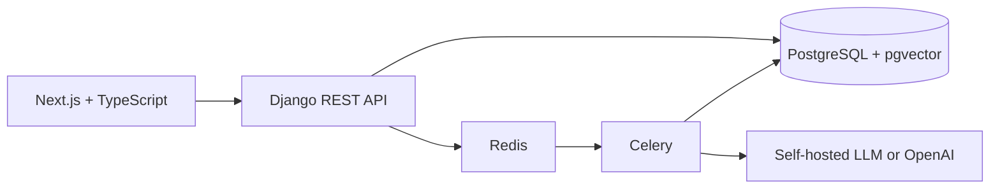

# DocuMind

DocuMind is a private, self-hostable AI assistant for company documents, built first for **Persian (Farsi)**. Upload PDF, TXT, DOCX, or Markdown files, organize them into collections, retrieve them semantically, and ask grounded questions that include structured source citations. With the `local` provider, the AI models run on the company's own server and document text never leaves it.

It is intentionally designed as a real portfolio project: a Django/DRF API with PostgreSQL + pgvector, Redis/Celery background processing, JWT authentication, a polished Next.js client, Docker Compose, CI, and focused tests.

## Features

- JWT registration, login, refresh, logout, profile management, and owner-enforced resources
- Defensive document upload validation: extension, MIME, format signature, safe filename, and configurable limits
- Non-blocking extraction pipeline with PDF, TXT, DOCX, and Markdown extractors
- Configurable overlapping chunking, deterministic retries, idempotent derived-data replacement, and status tracking
- Persian-first: right-to-left Persian interface, Persian text normalization (Arabic ي/ك, Persian/Arabic digits, diacritics, PDF presentation forms) applied to documents and queries, and answers in the language of the question
- Interchangeable AI providers: self-hosted (Ollama, vLLM, or any OpenAI-compatible server), OpenAI, or a deterministic mock for development and tests
- pgvector cosine similarity retrieval with owner, document, and collection filters; keyword search is available now and hybrid search can build on the same service boundary
- Grounded document/global chat, persisted conversations/messages, citations, and evidence-insufficiency behavior
- Short, detailed, key-point, and executive summaries; large summaries run through Celery
- Next.js + TypeScript + Tailwind interface with auth, dashboard, uploads, processing states, search, collections, chat, citations, and profile settings

## Architecture



See [docs/architecture.md](docs/architecture.md) for the data model, processing sequence, RAG safety boundary, and operational model.

## Quick start with Docker

```bash
cp .env.example .env
docker compose up --build
```

Open the client at `http://localhost:3000`, API documentation at `http://localhost:8000/api/docs/`, and the OpenAPI schema at `http://localhost:8000/api/schema/`.

For a credential-free local experience, leave `AI_PROVIDER=mock`: it uses a simple word-overlap embedding so search and chat still work (answers are the best matching excerpts, not generated text).

## Self-hosted AI (no data leaves the server)

1. In `.env` set `AI_PROVIDER=local`. The defaults use `bge-m3` for embeddings (multilingual, strong Persian) and `qwen2.5:7b` for answers.
2. Start the stack with the `local-ai` profile. The first run downloads the models (about 6 GB):

   ```bash
   docker compose --profile local-ai up --build
   ```

3. Wait until the `ollama-models` container exits successfully, then use the app as usual.

The embedding size is fixed in the database when it is first created (1024 for `bge-m3`, 1536 for OpenAI). When switching between providers, recreate the database with `docker compose down -v` and re-upload documents.

Hardware: `qwen2.5:7b` needs about 8 GB of RAM and is slow on CPU only; an NVIDIA GPU (add `-f docker-compose.yml -f docker-compose.gpu.yml` to the compose command) makes answers fast. On larger servers use `qwen2.5:14b` or bigger via `LOCAL_CHAT_MODEL`. Any OpenAI-compatible server (vLLM, LM Studio, a GPU box elsewhere on the company network) works by pointing `LOCAL_LLM_BASE_URL` at it.

To use OpenAI instead, set `AI_PROVIDER=openai` and `OPENAI_API_KEY`. Document excerpts are then sent to OpenAI.

## Local backend development

Requirements: Python 3.12+, PostgreSQL with the `vector` extension, and Redis. The quickest way to get the two services is Docker: `docker compose up -d postgres redis` (then add `ports` for them, or run your own).

```bash
python -m venv .venv
.venv/bin/pip install -e ".[dev]"          # Windows: .venv\Scripts\pip install -e ".[dev]"
cp .env.example .env                        # Windows: copy .env.example .env
# In .env set POSTGRES_HOST=localhost and REDIS_URL=redis://localhost:6379/0
python src/manage.py migrate
python src/manage.py runserver
# In a second terminal, from the src directory:
cd src && celery -A config.celery worker --loglevel=INFO   # Windows: add --pool=solo
```

Settings read `.env` from the repository root automatically; real environment variables take precedence. If you do not want to run a worker, set `CELERY_TASK_ALWAYS_EAGER=true` so uploads are processed inside the API request.

On Windows, activate the virtual environment using `.venv\Scripts\Activate.ps1`.

## Local frontend development

```bash
cd frontend
npm install
npm run dev
```

Set `NEXT_PUBLIC_API_URL` if the API is not on `http://localhost:8000/api/v1`.

## API outline

All application routes are versioned under `/api/v1/`.

| Area | Representative routes |
| --- | --- |
| Authentication | `auth/register/`, `auth/login/`, `auth/refresh/`, `auth/logout/`, `auth/me/` |
| Documents | `documents/`, `documents/{id}/`, `documents/{id}/download/`, `documents/{id}/processing_status/`, `documents/{id}/summarize/` |
| Search | `search/?q=...&mode=semantic` or `mode=keyword` |
| Collections | `collections/`, `collections/{id}/documents/` |
| Conversations | `conversations/`, `conversations/{id}/messages/` |

Schema and interactive documentation live at `/api/schema/` and `/api/docs/`.

## RAG and security model

For a question, DocuMind creates an embedding, retrieves owner-scoped chunks by cosine distance, constructs a labelled context, calls the chat provider, and returns the answer with document id, document name, page, and chunk id citations.

Uploaded text is untrusted. System instructions, user question, and retrieved text are sent in distinct prompt regions. The system instruction explicitly rejects instructions from documents, retrieval is never passed into executable tooling, and missing evidence returns a clear insufficiency message. Server querysets always apply ownership before a document, collection, chunk, conversation, or summary is returned.

Other protections include short-lived access JWTs, rotated/blacklisted refresh tokens, Django password validation, CORS and CSRF configuration, safe errors, filename and signature validation, configurable upload caps, no secrets in the repository, and request correlation without logging sensitive bodies.

## Quality checks

```bash
ruff check src tests
black --check src tests
mypy src
pytest
```

The test suite covers registration/password hashing, anonymous access, ownership isolation, upload queueing and file rejection, chunk overlap, RAG insufficiency behavior, and the prompt boundary. CI runs these checks and builds both Docker images.

## Project structure

```text
src/
  apps/accounts/       authentication and profile API
  apps/documents/      storage, extraction, chunks, embeddings, search, tasks
  apps/collections/    document grouping
  apps/conversations/  RAG, persisted chat, summaries
  apps/shared/         health, errors, structured request context
  config/              Django and Celery configuration
frontend/              Next.js App Router client
docs/                  architecture decision documentation
tests/                 API, domain, and RAG safety tests
```

## Limitations and roadmap

The included `mock` AI providers enable reliable development and tests but are not semantic models; use the `local` or `openai` provider for real retrieval quality. Scanned PDFs have no text layer and are not yet readable; Persian OCR is the next planned step, followed by organizations/teams with roles. File storage is local Docker-volume storage, suitable for the single-node deployment described here. A next production iteration would add S3-compatible object storage, antivirus scanning, a rate-limit backend, hybrid ranking, team sharing, analytics, and billing.

## License

Released under the [MIT License](LICENSE).

