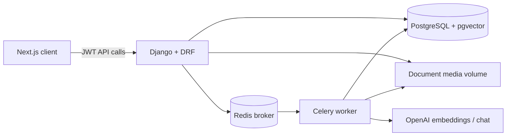
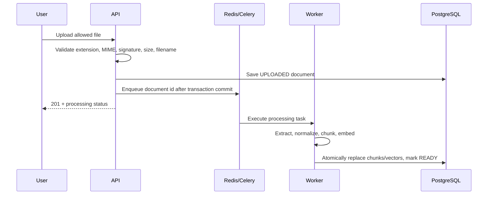
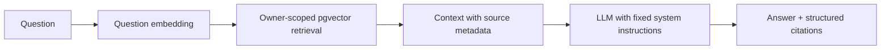
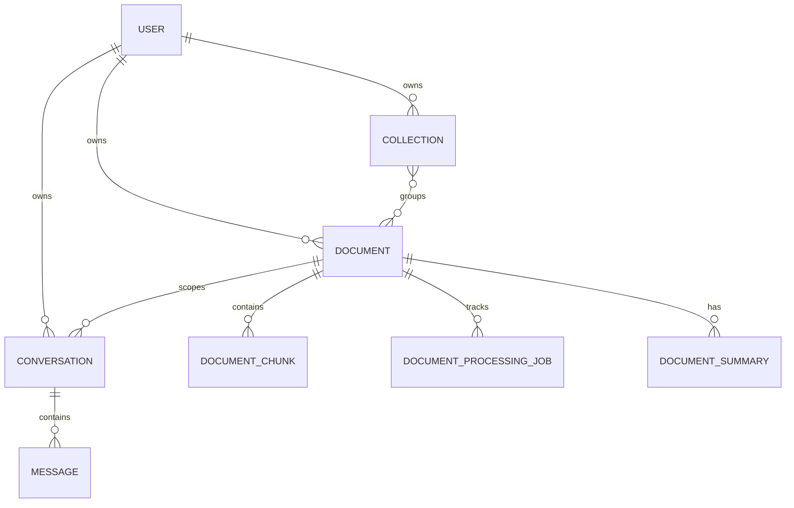

# DocuMind Architecture

DocuMind separates synchronous API work from expensive extraction and AI processing. Django owns validation, authentication, authorization, and durable workflow state; Celery workers own retryable document and large-summary tasks. PostgreSQL with pgvector is the system of record for document metadata and embeddings.

## Application boundaries

| Area | Responsibility |
| --- | --- |
| `accounts` | Registration, JWT lifecycle, profile data |
| `documents` | Upload validation, durable document records, extraction, chunking, embedding, retrieval |
| `collections` | User-owned document grouping |
| `conversations` | Persistent chat, citations, summaries |
| `shared` | Request correlation, health endpoints, consistent errors |

Views validate requests and enforce the current owner by deriving querysets from `request.user`. Processing and RAG logic lives in service modules so it can be tested without HTTP transport.

## Document pipeline

Retries replace chunks in one database transaction, making the derived data idempotent. A failed task records a safe user-facing status while the detailed exception remains internal to the job record.

## RAG safety and retrieval

Retrieved document content is wrapped as untrusted data. The system prompt tells the model not to follow commands within excerpts, and the application never routes retrieved text into a tool or executable path. No results produces an explicit insufficiency response rather than a speculative answer.

## Data relationships

## Operational model

`/health/` proves that the web process can serve requests. `/ready/` checks database connectivity and returns `503` when the database is not available. Request middleware supplies an `X-Request-ID` and records endpoint, status, latency, and user id without logging credentials or document bodies.
